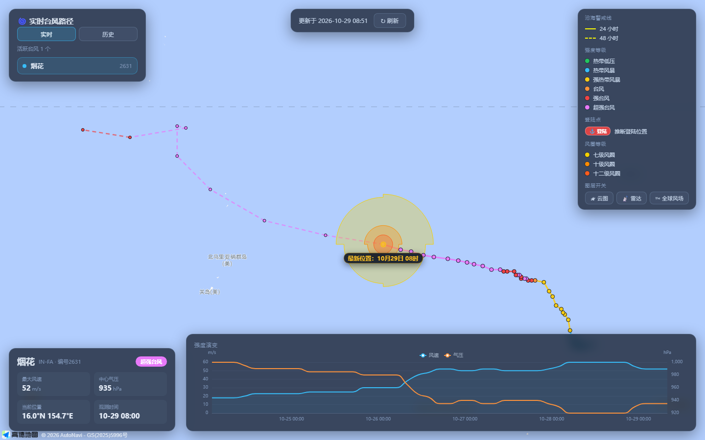
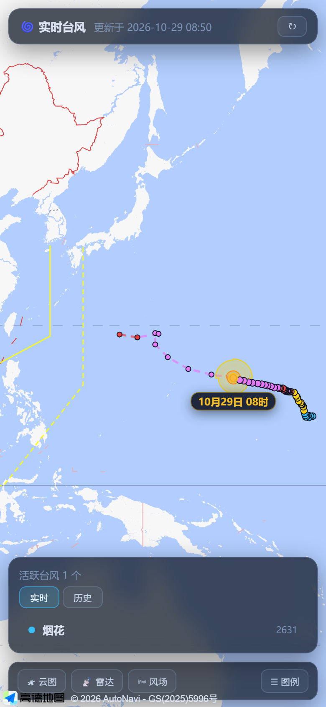

# 实时台风路径可视化

基于 Vue 3 + 高德地图的台风路径可视化应用（作品集/学习项目）。纯前端静态站，浏览器直接跨域拉取气象接口，无后端。

**在线演示**：https://jm642.github.io/typhoon-prediction/



| 手机端 |
| --- |
|  |

## 功能

- **实时台风**：活跃台风列表、实测路径（按强度分段着色）、当前中心脉冲标记、多档四象限风圈（七/十/十二级花瓣形嵌套）
- **预报路径**：虚线预报线（取 BABJ 最新时次快照），与实测路径衔接
- **历史浏览**：按年份（1949 至今）浏览已停编台风，详情按需加载并缓存
- **登陆点标注**：由轨迹 + 自然地球 110m 陆海掩膜推断登陆位置与时间（CMA 接口不含登陆字段）
- **强度演变曲线**：风速 / 中心气压双轴折线（ECharts，按需加载）
- **可选图层**：向日葵-9 卫星云图（NASA GIBS，z>7 自动拼合 overzoom）、气象雷达（NMC 分块图）、全球风场粒子（GFS）
- **点选交互**：点击路径点/中心查看强度、位置、风速、气压
- **响应式**：桌面浮层布局 / 手机底部抽屉布局

## 技术栈

| 层 | 选型 |
| --- | --- |
| 框架 | Vue 3（组合式 API）+ TypeScript |
| 构建 | Vite 6 |
| 地图 | 高德 JS API 2.0（`@amap/amap-jsapi-loader`） |
| 图表 | ECharts 5（按需引入 + 异步加载） |
| 部署 | GitHub Pages（Actions 自动构建发布） |

## 快速开始

```bash
npm install
cp .env.example .env      # 填入高德 Web 端 Key 与安全密钥
npm run dev               # http://localhost:5173
```

`.env` 需要在高德开放平台申请：

```env
VITE_AMAP_KEY=...
VITE_AMAP_SECURITY_JSCODE=...
```

未配置时页面会显示错误提示，地图不渲染。

### 开发命令

```bash
npm run dev        # 本地开发
npm run build      # 类型检查 + 构建
npm run typecheck  # 仅类型检查
npm run smoke      # 冒烟测试：真实请求 CMA 接口，校验剥壳与归一化
```

## 数据来源

| 数据 | 来源 | 说明 |
| --- | --- | --- |
| 台风列表 / 路径 / 预报 | [中央气象台台风网](https://typhoon.nmc.cn/) | JSONP 包装，需剥壳后解析；CORS `*`，不可加自定义请求头 |
| 卫星云图 | NASA GIBS（向日葵-9 AHI） | 标准 XYZ 瓦片，无需密钥 |
| 气象雷达 | 中央气象台台风网 | 2×2 分块 PNG，先取时间戳再挂图层 |
| 全球风场 | 浙江省水利厅台风网（GFS） | GRIB2JSON 格式，客户端 3 小时缓存 |

## 架构

```
页面加载
  └─ src/api/typhoon.ts（唯一数据入口：抓取 + 剥壳 + 归一化）
       ├─ fetchTyphoonList()        → list_default
       ├─ fetchTyphoonYearList(y)   → list_<年份>
       └─ fetchTyphoonDetail(id)    → view_<id>
  → Vue 组件消费归一化后的 NormalizedTyphoon
  → TyphoonLayer 自绘到 Canvas，叠加云图/雷达/风场图层
```

组件不接触原始接口；未来若加后端代理，只需改 `src/api/*` 的实现。

几个刻意的设计取舍：

- **自绘矢量**：高德 2.0 把矢量覆盖物与底图合成在同一张 canvas，`zIndex` 无法保证路径盖在风场之上，因此路径/风圈改为自绘到独立 `CustomLayer`（zIndex 110），点击用像素命中。
- **不转换坐标系**：CMA 数据为 WGS-84，直接叠加在 GCJ-02 底图上，偏移约数百米，对本项目的展示目的可接受。
- **风场引擎**：`src/lib/windy.ts` 忠实移植自 cambecc/earth，仅去掉 Leaflet 耦合、改由参数注入投影函数。

## 已知限制

- CMA 接口无 SLA，字段或包装格式变动可能导致数据缺失
- 登陆点为**推断值**：110m 陆海掩膜精度有限，小岛缺失；擦过海岸线的轨迹可能被记为登陆
- 卫星云图在 z≥7 切换为可见光波段，夜间放大后画面偏暗
- 历史年份数据量大，详情按需加载（缓存上限 30 条）

## 目录结构

```
src/
├── api/          # 数据层：台风 / 云图雷达 / 风场
├── components/   # 图层与浮层组件
├── composables/  # 高德地图实例生命周期
├── constants/    # 强度等级、风圈、图层范围等常量
├── data/         # 陆海掩膜、警戒线静态数据
├── lib/          # 风场粒子引擎、登陆点推断、格式化
└── types/        # 归一化领域类型
```
